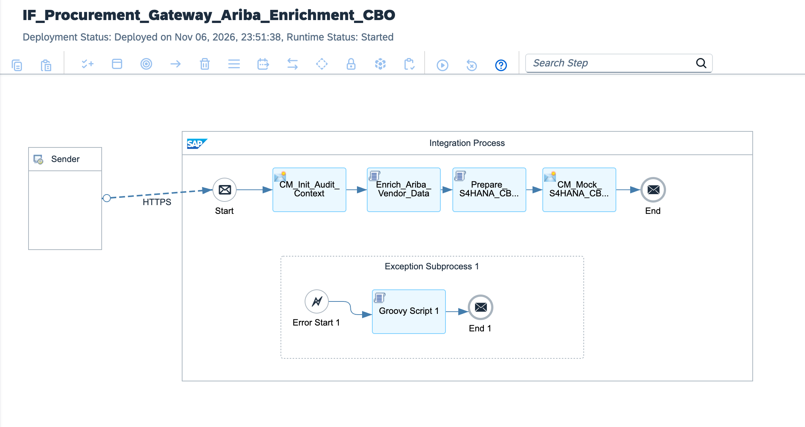

# Enterprise Procurement Modernization: Supplier Quality Gateway, APIM Edge Security & Clean Core CBO

[](https://www.sap.com)
[](https://www.sap.com)
[](https://www.ariba.com)
[](https://www.sap.com)
[-success?style=for-the-badge&logo=sap&logoColor=white)](https://www.sap.com)

---

## Executive Summary

Global procurement landscapes frequently struggle with integrating external supplier audit data, certificate of analysis (CoA) manifests, and non-conformance records into SAP S/4HANA. Historical architectures relied on custom ABAP Z-tables, unauthenticated direct RFCs, and brittle batch file processing, directly violating **S/4HANA Clean Core** principles and creating substantial upgrade debt.

This architecture delivers an **Enterprise Clean Core Procurement Gateway**:
1. **APIM Edge Protection & Spike Arrest:** Shields the core ERP runtime by enforcing OAuth 2.0 client credentials, rate limiting, and Spike Arrest policies (100 req/min) at the perimeter layer.
2. **In-Flight Schema & Quality Score Validation:** Validates ISO/ASTM quality inspection tolerances and supplier certificate validity dates in RAM before persisting records.
3. **Clean Core Custom Business Object (CBO) Dispatch:** Translates supplier quality inspections into standardized S/4HANA **Custom Business Objects (CBO)** via transactional **OData V4** APIs, maintaining upgrade-readiness without modifying SAP core code.
4. **Asynchronous Non-Conformance DLQ:** Isolates rejected quality inspection batches and expired vendor certifications into an encrypted Dead-Letter Queue (DLQ) with instant notification hooks for procurement officers.

---

## Architecture Overview



### High-Level Topology

```text
[External Supplier Portal / Ariba Open Connectors]
          │
          │ HTTPS POST (TLS 1.3 / OAuth 2.0 Bearer Token)
          ▼
[SAP API Management (APIM Edge Gateway)]
  ├── Spike Arrest & Rate Limiting Enforcement (100 req/min)
  └── JSON Threat Protection & CORS Policies
          │
          ▼ Routed via Dedicated mTLS Virtual Host
[SAP Integration Suite: IF_Procurement_SupplierQuality_To_S4HANA_CBO]
  │
  ├── 1. Context & Header Normalization (CM_Init_Procurement_Context):
  │    └─ Injects correlation headers, vendor GUIDs, and ISO audit timestamps
  │
  ├── 2. Supplier Quality Gatekeeper (Validate_Supplier_Quality_Score.groovy):
  │    ├─ Evaluates ASTM quality test measurements against tolerance boundaries
  │    ├─ Flags expired CoA certificates and out-of-spec batches
  │    └─ Injects quality disposition flag (ACCEPTED / REJECTED_DISCREPANCY)
  │
  ├── 3. Compliance Quality Router (Router_Quality_Disposition):
  │    ├─ [Quality Breach / Expired CoA] ──► CM_Quarantine_Alert ──► Quarantined DLQ
  │    └─ [Inspection Passed (QualityScore >= 90)] ──► Continue to ERP Commit
  │
  ├── 4. CBO OData V4 Payload Builder (Build_S4HANA_CBO_ODataV4.groovy):
  │    └─ Encapsulates payload into S/4HANA Custom Business Object structure
  │
  ├── 5. Outbound S/4HANA Dispatch:
  │    └─ HTTP OData V4 Adapter (/sap/opu/odata4/sap/yy1_supplierqualitycbo/srvd_a2x)
  │
  └── 6. Exception Subprocess (Format_Procurement_DLQ.groovy):
       └─ Dumps schema failures and network timeouts to secure procurement DLQ
```

---

## Technical Specifications

| Architectural Dimension | Legacy ABAP RFC / Z-Table Architecture | Clean Core Procurement Gateway (CBO + OData V4) |
| :--- | :--- | :--- |
| **Edge Security** | Direct access to S/4HANA application server | SAP API Management with OAuth 2.0 & Spike Arrest |
| **Data Schema** | Monolithic custom Z-tables inside S/4HANA core | Cloud-native S/4HANA Custom Business Object (CBO) |
| **Inspection Logic** | Brittle user-exits and BAdI implementations | In-flight Groovy pre-flight quality gatekeeper in CPI |
| **ERP Mutation** | Invasive RFC function modules | Decoupled S/4HANA OData V4 RESTful services |
| **Upgrade Safety** | High upgrade risk; blocks cloud ERP modernization | 100% Clean Core compliant; zero ERP core modification |
| **Dead-Letter Handling**| SM58/SM21 system dump investigation | Automated payload quarantine with business triage hooks |

---

## S/4HANA Custom Business Object (CBO) OData V4 Payload

```json
{
  "SupplierID": "SUP-77410-DE",
  "PurchaseOrder": "4500098412",
  "PurchaseOrderItem": "00010",
  "MaterialID": "MAT-PRECISION-BEARING-99",
  "BatchNumber": "LOT-2026-X8",
  "CertificateOfAnalysisID": "COA-DE-2026-00412",
  "CertificateExpirationDate": "2027-11-01",
  "MeasuredToleranceMicroMM": 0.042,
  "QualityInspectionStatus": "APPROVED_A_GRADE",
  "QualityScore": 98.5,
  "AuditHashSHA256": "8f4a1c6e492b...d3810a",
  "InspectedBy": "SYSTEM_APIM_GATEWAY"
}
```

---

## Repository Structure

```text
├── README.md                                             # Enterprise architecture & operations runbook
├── sap-cpi-procurement-gateway-runtime-architecture.png # Integration flow runtime topology diagram
├── ADR-006-Procurement-Gateway-CleanCore-CBO.md         # Architecture Decision Record
├── IF_Procurement_SupplierQuality_To_S4HANA_CBO.zip     # Production iFlow runtime bundle export
├── cpi/
│   └── scripts/
│       ├── Validate_Supplier_Quality_Score.groovy        # In-flight tolerance & CoA date validator
│       ├── Build_S4HANA_CBO_ODataV4.groovy              # Canonical CBO OData V4 payload assembler
│       └── Format_Procurement_DLQ.groovy                 # Procurement incident & dead-letter handler
├── tests/
│   ├── sample_valid_quality_inspection.json              # Valid supplier quality test payload
│   └── sample_expired_coa_payload.json                   # Discrepancy test payload triggering DLQ
└── .gitignore                                            # Git exclusion rules
```

---

## Verification & Deployment Runbook

### 1. Inbound Endpoint Verification
Confirm runtime endpoint status in **Monitor** ──► **Manage Integration Content**:
```text
https://<tenant-runtime>.cfapps.<region>[.hana.ondemand.com/http/procurement/supplier/quality/sync](https://.hana.ondemand.com/http/procurement/supplier/quality/sync)
```

### 2. Dispatched cURL Test (Happy Path)
Execute an authorized POST request using valid inspection data:

```bash
curl -X POST \
  'https://<tenant-runtime>.cfapps.<region>[.hana.ondemand.com/http/procurement/supplier/quality/sync](https://.hana.ondemand.com/http/procurement/supplier/quality/sync)' \
  -H 'Content-Type: application/json' \
  -H 'Authorization: Bearer <BTP_OAUTH_TOKEN>' \
  --data-binary '@tests/sample_valid_quality_inspection.json'
```

### 3. Monitoring Trace
* Inspect execution under **Monitor Message Processing**.
* Verify properties `Quality_Score_Status = PASSED`, `Supplier_ID`, and `S4HANA_CBO_Document_ID`.
* Confirm that HTTP 201 Created is returned from the S/4HANA CBO OData V4 service.

---

## Author

**Željko Popov**  
*Integration Architect | SAP Integration Suite & Clean Core Specialist*  
[GitHub Repositories](https://github.com/neurozeljko)
